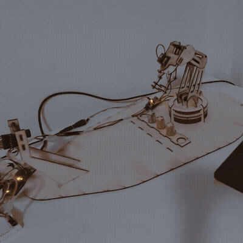

# Machine-Vision Robotic Sorting Arm

Low-cost 4-DOF robotic arm that identifies and sorts colour-coded
pharmaceutical vials autonomously. MSc dissertation, University of Liverpool, 2026.

* Full autonomous sorting run (2× speed, reduced frame rate). *
** The arm is instructed to move red vials to the right and blue vials to the left, and to leave green vials in place. **

## Results
- 0.58° mean joint-position error (2° max)
- 16 of 18 end-to-end sorts completed without intervention (88.9%)

## How it works
- **Vision (Python):** HSV-based colour classification using region-of-interest sampling to identify vials at predefined positions.
- **Kinematics (Python):** Closed-form inverse kinematics to calculate joint angles for the 4-DOF arm, with Cartesian waypoints and joint limits.
- **Control (Arduino C++):** Calibrated servo motion control via a PCA9685 PWM controller to execute autonomous pick-and-place sequences.

## Repository structure
- `python/` – vision and kinematics
- `arduino/` – motor control firmware
- `report/` – full dissertation (PDF)
